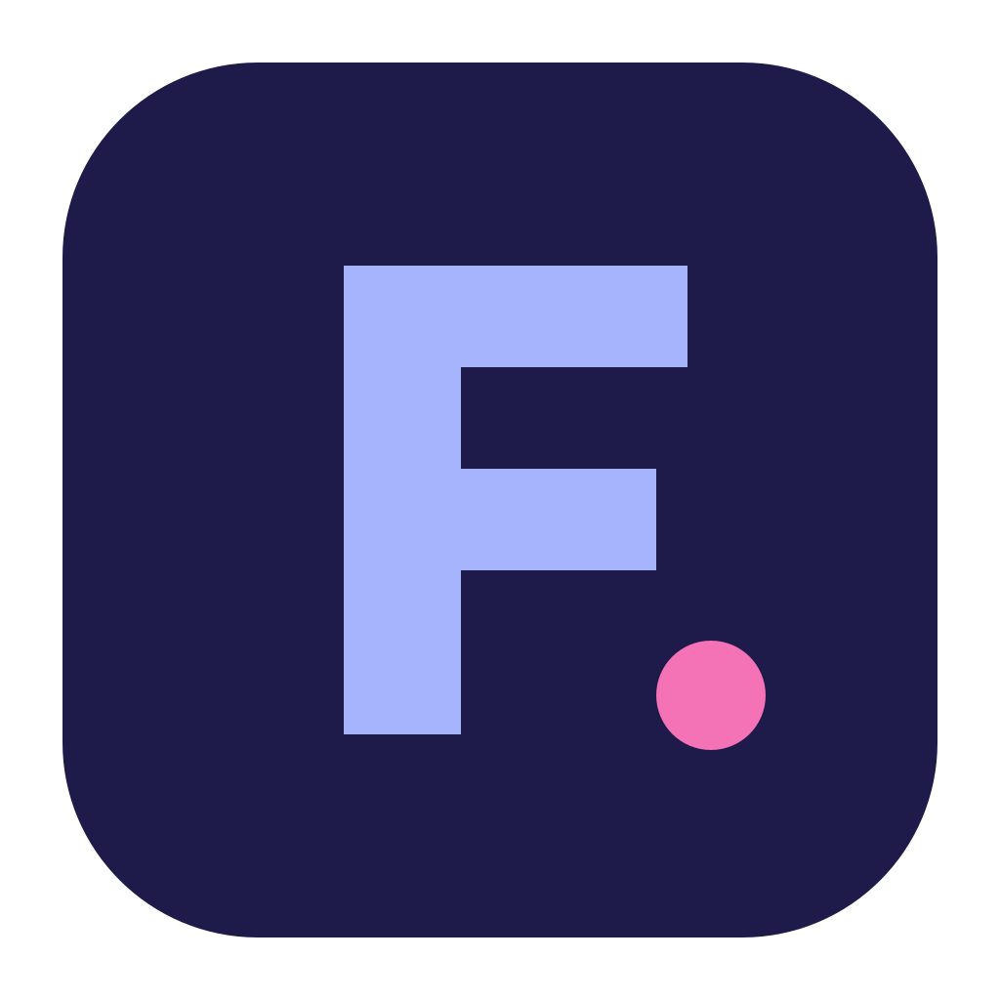

<p align="center">
  
</p>

<h1 align="center">Frida</h1>

<p align="center">
  <em>Fast Request Inspector for Developer APIs</em><br>
  A local-first desktop HTTP client. Your requests are plain YAML files in your git repo.
</p>

---

Frida is an alternative to Postman and Bruno, built with Rust, Tauri 2 and React. There is no account, no cloud and
no telemetry: collections are folders of YAML files that you commit next to your code, and secret values stay in
your operating system's keychain.

## Features

- **Files, not a database.** One YAML file per request, with clean diffs. Workspaces → collections → folders →
  requests, with headers, auth, variables and scripts inherited down the tree. [File format](docs/file-format.md)
- **Environments and variables** on six layers (runtime, request, folder, collection environment, collection,
  global environment). The **variable inspector** shows every `{{variable}}` a request uses, its value, where it
  comes from and what it shadows.
- **Secrets stay out of git.** Only `secret: true` is written; values live in the macOS Keychain, Windows
  Credential Manager or Linux Secret Service, or come from **AWS Secrets Manager**. They are masked in the
  console, history and curl exports.
- **Auth**: Basic, Bearer, API key, OAuth2 (client credentials, password, authorization code + PKCE, Cognito
  preset), and combinations such as OAuth2 + API key. Tokens are cached and refreshed.
- **Scripts and tests** in JavaScript (sandboxed QuickJS), compatible with Bruno's `bru`/`req`/`res` API.
  [Scripting reference](docs/scripting.md)
- **Collection runner**: run a collection or folder in order, with scripts that skip, jump or stop.
- **Import** OpenAPI 3.0/3.1, Bruno collections (`.bru` and YAML) and curl commands. **Export** curl (bash or
  PowerShell) and Frida archives.
- **Git panel**: status, side-by-side diffs, stage, commit, push, fast-forward pull, branch switch, using your own
  `git` and SSH keys.
- History, a console with the raw exchange, cookie jars, response search and JSONPath filter, image and HTML
  preview, dark and light themes, keyboard-first (Cmd/Ctrl+K quick open).
- **Updates itself**: a signed update check once a day (can be switched off), installed only when you say so.

Not supported (yet): WebSockets, GraphQL, gRPC, SSE, Postman import. A CLI runner for CI and HTTP proxy support are
planned, see the [roadmap](PLAN.md#15-milestones).

## Install

Installers are attached to [GitHub Releases](https://github.com/Clon1998/frida/releases) (the first public
release is still being prepared; until then, build it yourself or grab a CI build, see
[Development](docs/development.md#ci)):

| Platform | File |
|---|---|
| macOS (Apple silicon / Intel) | `Frida_<version>_aarch64.dmg` / `Frida_<version>_x64.dmg` (signed and notarized) |
| Windows | `Frida_<version>_x64-setup.exe` or `.msi` |
| Linux | `.AppImage`, `.deb` or `.rpm` |

The Windows and Linux builds aren't code-signed yet. On Windows, SmartScreen asks once: **More info → Run anyway**.
On Linux, make the AppImage executable with `chmod +x`.

## Getting started

1. Start Frida and choose **New workspace…** (a new folder) or **Open workspace…** (an existing one).
2. Add a collection: **New collection…** creates one inside the workspace, **Add existing collection…** picks a
   folder anywhere (for example in your API's repo). Or import one from OpenAPI, Bruno or a Frida archive.
3. Add a request, type a URL, press **Cmd/Ctrl+Enter**.
4. Create an environment (the environment button in the breadcrumb bar, or **Cmd/Ctrl+E**), add `baseUrl`, and use
   `{{baseUrl}}` in your URLs.
5. Commit the collection folder to git. Your colleagues get the same requests; each of them enters the secret
   values once on their machine.

The [user guide](docs/user-guide.md) explains all of it in more detail.

### Try it with the sample workspace

From a clone of this repository:

```sh
cargo run -p frida-testserver      # an echo server on http://localhost:8787
```

Then open `testdata/sample-workspace` in Frida and send the requests under *Methods*, *Body types*, *Variables*
and *Scripting*.

## Documentation

| Document | For |
|---|---|
| [User guide](docs/user-guide.md) | Concepts, variables, secrets, auth, runner, import/export, git, shortcuts |
| [Scripting & tests](docs/scripting.md) | The `fri`/`req`/`res`/`expect` API and what differs from Bruno |
| [File format](docs/file-format.md) | What the YAML files look like and what stays on your machine |
| [Architecture](docs/architecture.md) | Crates, the send pipeline, Rust ↔ TypeScript bindings, adding a feature |
| [Development](docs/development.md) | Setup, running, tests, CI |
| [Releasing](docs/releasing.md) | Versioning, the release workflow, macOS signing |
| [PLAN.md](PLAN.md) | The specification, milestones and decisions log |
| [Changelog](docs/CHANGELOG.md) | What each milestone added |

## Development

You need Rust (stable), Node.js 24, pnpm 12 and your platform's webview build tools
([details](docs/development.md#prerequisites)). Then:

```sh
cd app && pnpm install
pnpm tauri dev                     # the app, with hot reload for the UI
```

Checks that CI runs (and every change must pass):

```sh
cargo fmt --all
cargo clippy --workspace --all-targets -- -D warnings
cargo test --workspace
cd app/ui && pnpm typecheck && pnpm lint && pnpm test && pnpm e2e
```

`pnpm tauri build` in `app/` builds installers for your OS into `target/release/bundle/`. See
[development.md](docs/development.md) for everything else and [architecture.md](docs/architecture.md) for where
code goes.

## Your data

Frida writes only the YAML files of your workspace and collections. Everything else stays in its app data folder:
settings, open tabs, history and logs (`~/Library/Application Support/io.github.clon1998.frida/` on macOS,
`%APPDATA%\io.github.clon1998.frida\` on Windows, `~/.local/share/io.github.clon1998.frida/` on Linux). Secret
values are only in the OS keychain. Frida only talks to the network for what you ask it to do: your requests, their
OAuth2 token calls, AWS secrets you configured, git push/pull/fetch, and the daily update check against GitHub
(switch it off in Settings → Updates).

## Name

The logo is a Westie, traced from a one-line drawing (`assets/logo/`). The binary is called `frida-http` so it
doesn't clash with the [frida](https://frida.re) instrumentation toolkit.
